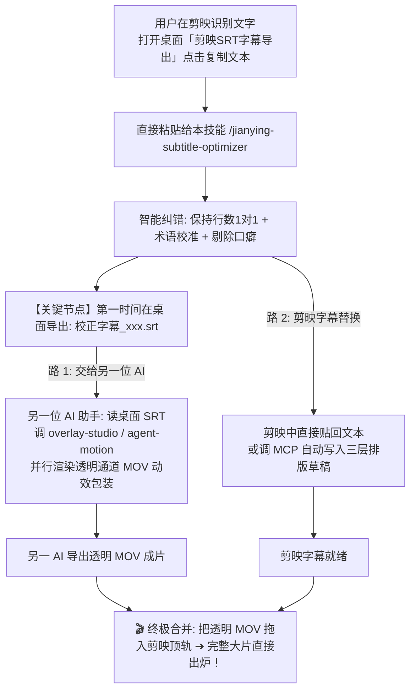

# 剪映字幕智能校对与视觉精排技能 (JianYing Subtitle Optimizer)

本技能用于实现**剪映字幕的高效智能校对、三层视觉排版与多智能体并行视频包装**。
用户通过桌面上的「剪映SRT字幕导出」工具一秒复制台词发给智能体，智能体即可自动完成「智能纠错 -> 桌面生成标准 SRT -> 多智能体并行制作 -> 剪映一键替换/安全写回」。

---

## 🎯 触发场景

当用户提出以下需求或直接粘贴台词时，必须使用本技能：
- 用户从「剪映SRT字幕导出」点击【📋 复制文本】后，粘贴文本并发起请求：
  * “帮我校对这段剪映字幕”
  * “这是刚导出的字幕文本，帮我校正一下”
- 斜杠命令：`/jianying-subtitle-optimizer [附带台词文本]`
- （兼容模式）：用户未粘贴文本时说“校对剪映最新草稿”，智能体通过本地 MCP 自动探测最新草稿。

---

## 🚀 多智能体并行包装协作流 (Parallel AI Pipeline)

---

## 📋 执行 SOP（核心四步）

### 第一步：获取字幕文本（用户直接粘贴为主）

1. **主流标准模式（用户主导，1秒完成，零冲突风险）**：
   - 用户打开桌面上的 **`剪映SRT字幕导出`**；
   - 选中目标草稿，点击右下角 **【📋 复制文本】**；
   - 直接将整段台词粘贴在对话中发给智能体。
2. **自动探测模式（备用兜底）**：
   - 若用户未附带文本，调用本地 MCP 工具 `get_latest_draft_subtitles` 自动定位最新草稿并提取字幕。

---

### 第二步：智能校对与纠错铁律

智能体对字幕逐句进行专业校准，严格遵循四大规则：

1. **【铁律】严格 1 对 1 行数对齐（总行数绝对守恒）**：
   - 校对后的列表长度必须与原文本行数完全相等（`len(corrected_lines) == len(lines)`）；
   - **严禁擅自合并行或跨行拆分**，确保每一行对应剪映时间轴上的一个独立字幕切片！
2. **清除口语废话与结巴卡顿**：
   - 彻底剔除“这个呃”、“然后呢”、“啊”、“那额度了”、“嗯”、“诶”等口语碎词，保持呼吸感与节奏感。
3. **专有名词与技术模型专业校准（结合本机事实）**：
   - `Claude open 十五点五` / `OPPO S5.5` ➔ **Claude Opus 5.5**
   - `GPT6.1SO` ➔ **GPT-6.1-Sol**
   - `workbody的H3` ➔ **WorkBuddy 的 Hy3**
   - `GPT plus` / `Claude的Pro` ➔ **ChatGPT Plus** / **Claude Pro**
   - 专业工具正字：`FocuSee`、`OpenFilm`、`FaceFusion`、`overlay-studio` 等。
4. **语法倒错纠偏**：
   - 修正“审美了很好” ➔ “审美非常好”、“我给他建议” ➔ “我给大家的建议”。

---

### 第三步：第一时间生成桌面 SRT（供并行 AI 助手）

校对完成后，第一时间在桌面落盘生成：
* 📄 **`C:\Users\Administrator\Desktop\校正字幕_最新.srt`**（带时码的标准 SRT）
* 📄 **`C:\Users\Administrator\Desktop\校正字幕_最新.txt`**（纯文本一行一句）

**立即提示用户**：
> 💡 *“校正后的标准 SRT 字幕已生成至桌面！你现在可以立即把该文件发送给另一个 AI 助手（如调用 `/overlay-fx-generator` 或 `agent-motion`）同步制作透明动效层！”*

---

### 第四步：剪映回填与排版（双途径自由选择）

智能体输出校对好的【纯文本剪映贴回版】，并告知用户两种最轻松的生效方式：

* **途径 A（最自由快速）：剪映批量编辑直接全选粘贴**
  1. 在剪映时间轴上选中字幕轨，点击右上角【文本】➔【批量编辑】；
  2. 快捷键 `Ctrl + A` 全选，`Ctrl + V` 粘贴校正后的文本，原有时码 100% 保持不动，字幕瞬间全量替换纠正！
* **途径 B（全自动高质感）：调用 MCP 原地注入三层排版**
  - 如果用户说“帮我写回剪映并排版”，智能体调用本地 MCP 工具 `update_draft_subtitles`：
    * 自动生成独立副本 `【<原草稿名> (AI精修字幕)】`（安全避开剪映内存锁）；
    * 注入三层排版：底层研宋体阴影（<=8字）、中层经典黑胸前高光字、顶层雅月体花字标题。

---

### 第五步：双路合并指南

当另一位 AI 助手将动效视频（带透明通道的 ProRes 4444 MOV）渲染完成后：
1. 用户直接将 MOV 拖入剪映时间轴的最顶层轨道；
2. 剪映中的声音、校正字幕与顶层的精美动态卡片严丝合缝对齐；
3. 点击导出，一条高质感商业级口播大片直接搞定！
